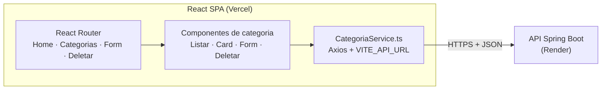

<div align="center">

# 💊 Farmácia do Logan — Front-end

Interface em React para gerenciar as categorias de produtos de uma farmácia, consumindo uma API REST em Spring Boot.


[](https://github.com/Day-Barbosa/farmacia/actions/workflows/ci.yml)


**[🌐 Aplicação ao vivo](https://farmacia-omega-eight.vercel.app/)** · **[⚙️ API (farmacia-api)](https://github.com/Day-Barbosa/farmacia-api)**

</div>

---

<!-- 📸 MÍDIA: grave um GIF curto (home com o hover do Logan → listar categorias → cadastrar → editar → deletar) e salve em docs/demo.gif. Depois troque este comentário por:
<p align="center"></p>
-->

## 💡 Sobre o projeto

Front-end do par **Farmácia** (API + web): permite listar, cadastrar, editar e excluir as **categorias** que organizam os produtos da farmácia, com navegação SPA e uma camada de serviço que isola as chamadas HTTP. Tem um *easter egg*: passe o mouse sobre o nome "Logan" na home. 🐱

## 🏗️ Arquitetura e decisões técnicas



| Decisão | Por quê |
|---|---|
| **`CategoriaService` tipado** | Cada função devolve `Promise<Categoria>` ou `Promise<Categoria[]>`, então os componentes não conhecem detalhes do Axios. |
| **Mesmo formulário para criar e editar** | `FormCategoria` decide o modo pelo `:id` da rota, sem duplicar tela. |
| **Exclusão com confirmação** | Rota própria (`/deletarcategoria/:id`) mostra os dados antes de apagar. |
| **`VITE_API_URL`** | O mesmo código aponta para a API local ou de produção. |
| **`vercel.json` com rewrite** | Links diretos e F5 em rotas internas funcionam no deploy. |

## ✨ Funcionalidades

- Navegação SPA com React Router (Home, Categorias, Nova Categoria)
- Listagem de categorias em cards responsivos
- Cadastro e edição de categorias no mesmo formulário
- Exclusão com tela de confirmação
- Layout com Tailwind CSS

## 🗺️ Rotas

| Rota | Componente | Descrição |
|---|---|---|
| `/` | `Home` | Página inicial |
| `/categorias` | `ListarCategorias` | Lista as categorias |
| `/cadastrarCategoria` | `FormCategoria` | Cadastro |
| `/editarcategoria/:id` | `FormCategoria` | Edição |
| `/deletarcategoria/:id` | `DeletarCategoria` | Confirmação de exclusão |

## 🚀 Como rodar localmente

**Pré-requisito:** Node.js 20+.

```bash
git clone https://github.com/Day-Barbosa/farmacia.git
cd farmacia
npm install
cp .env.example .env.local      # opcional: aponta para a API local
npm run dev
```

Abra **http://localhost:5173**. Sem `.env.local`, o front usa a API em produção.

| Script | O que faz |
|---|---|
| `npm run dev` | Servidor de desenvolvimento |
| `npm run build` | Checagem de tipos + build de produção |
| `npm run lint` | ESLint |

O GitHub Actions roda `lint` e `build` a cada push.

## 📁 Estrutura

```text
src/
├── components/
│   ├── categorias/   # CardCategoria, DeletarCategoria, FormCategoria, ListarCategorias
│   ├── footer/
│   └── navbar/
├── models/           # Categoria, Produto
├── pages/home/
└── services/         # CategoriaService (Axios)
```

## 🗺️ Próximos passos

- [ ] Tela de login e envio do token JWT (a `farmacia-api` exige token para cadastrar, editar e excluir)
- [ ] CRUD de produtos com filtro por categoria
- [ ] Feedback visual de sucesso e erro nas operações

## 👩‍💻 Autora

**Dayana Barbosa** · [LinkedIn](https://www.linkedin.com/in/dayanabarbosa-devjava/) · [GitHub](https://github.com/Day-Barbosa)

Projeto desenvolvido na formação Java Fullstack da Generation Brasil.

---

<sub>Distribuído sob a licença MIT. Veja [`LICENSE`](LICENSE).</sub>
